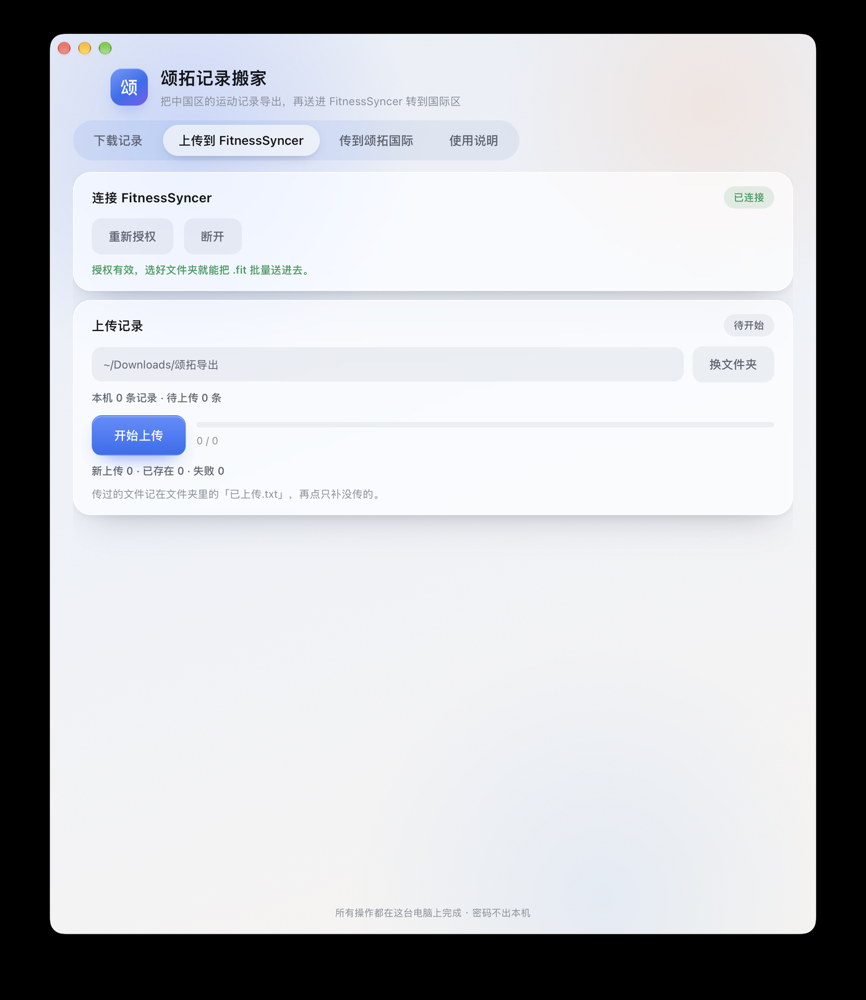
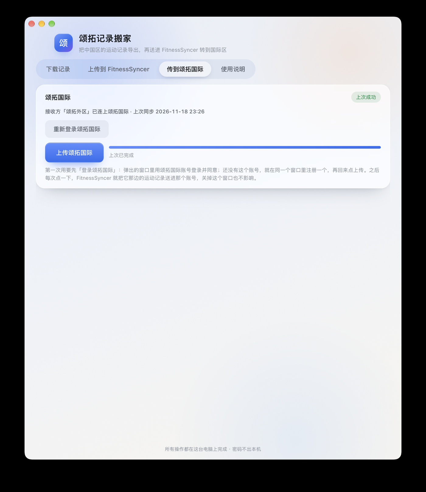
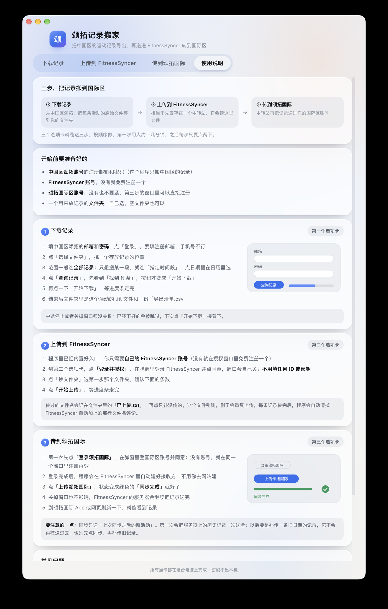

# 颂拓记录搬家 · Suunto Bridge

把 **颂拓中国区账号** 里的运动记录，搬到你的 **颂拓国际区账号**。Mac 桌面程序，界面和授权都在本机完成，颂拓密码只交给颂拓服务器。

> Move your Suunto China activities to your Suunto international account via your own FitnessSyncer account. macOS app, local-first.

## 它做什么

颂拓中国区（`api.suunto.cn`）和国际区（`api.sports-tracker.com`）是两套互不相通的账号，官方没有迁移入口，App 里只能一条一条导出。这个程序把三段流程做成三个选项卡：

| 选项卡 | 做什么 |
| --- | --- |
| ① 下载记录 | 登录中国区账号，按「全部」或「指定时间段」把每条活动的原始 `.fit` 存到你的文件夹，并生成「导出清单.csv」 |
| ② 上传到 FitnessSyncer | 点一次「登录并授权」（程序内置公共 OAuth 客户端，**不用注册开发者应用、不用填 ID 或密钥**），把文件夹里的 `.fit` 全部传进 FitnessSyncer 的 Notebook |
| ③ 传到颂拓国际 | 在 FitnessSyncer 里建好到颂拓国际的接收方，触发同步，由 FitnessSyncer 把记录送进你的国际区账号 |

第四个选项卡是给第一次用的人看的使用说明。

中途停止、关掉程序都没关系：已下好的文件会跳过，已传过的文件名记在文件夹里的「已上传.txt」。

## 为什么需要绕这一圈

导出是读接口，登录就能做；写进颂拓要合作方资格，自己拼请求进不去。FitnessSyncer 是颂拓官方合作方之一，能代你把活动写进国际区账号，所以中间借它中转一次。

## 下载安装

到 [Releases](../../releases) 下载最新的 `.dmg`，打开后把「颂拓记录搬家」拖进「应用程序」。

- 需要 **macOS 13 或更高**，目前发布的是 **Apple 芯片（M1 及以后）** 版本。
- 没有做 Apple 开发者签名和公证，**第一次打开要右键点图标 →「打开」→ 再点一次「打开」**。直接双击会被系统拦住。

## 界面与操作

四张图就是程序里的四个选项卡。

### ① 下载记录


1. 填中国区颂拓的**注册邮箱**和密码，点「登录」（手机号登不进去）
2. 点「选择文件夹」，挑一个存放记录的位置，可以直接用默认的 `~/Downloads/颂拓导出`
3. 范围一般选「全部记录」；只想搬某一段，就选「指定时间段」，点日期框在日历里选
4. 点「查询记录」，先看到「找到 N 条」，按钮变成「开始下载」，再点一下

### ② 上传到 FitnessSyncer



1. 点「登录并授权」，在弹出的窗口里登录**你自己的 FitnessSyncer 账号**并点同意；没有账号就在同一个窗口里免费注册。窗口会自己关，**不用填任何东西**
2. 点「换文件夹」选第一步那个文件夹，确认下面显示的条数
3. 点「开始上传」

### ③ 传到颂拓国际



1. 第一次先点「**登录颂拓国际**」，在弹窗里登国际区账号并同意；没有账号，就在同一个窗口里注册再登
2. 登录完成后，程序会在 FitnessSyncer 里自动建好接收方；蓝色按钮变成「**上传颂拓国际**」
3. 点它，状态变成绿色的「同步完成」就好了；关掉窗口也不影响，FitnessSyncer 的服务器会继续把记录送完

### ④ 使用说明



程序里的「使用说明」选项卡，和上面的步骤是同一套内容。

## 用之前准备好

- 中国区颂拓账号的**注册邮箱**和密码（手机号登不进去）
- **FitnessSyncer 免费账号**（授权过期时点一下「重新授权」即可，不用重新注册应用）
- 颂拓国际区账号；没有也不要紧，第三选项卡的窗口里可以注册
- 一个用来放记录的**文件夹**，自己选，空文件夹也可以

### FitnessSyncer 授权，为什么不用填任何东西

程序内置了一个 FitnessSyncer **公共 OAuth 客户端**：公开类型、没有客户端密钥、按规范强制使用 PKCE。点「登录并授权」后，浏览器把授权结果带回本机，程序再用一次性的校验码换回令牌。令牌属于**在弹窗里登录的那个人**，记录进的是那个人的 FitnessSyncer 账号。

公共客户端 ID 出现在源码里是它本来的设计，它只代表「是哪个程序在请求」，不含任何密钥，也动不了任何人的账号——除非账号主人本人在授权窗口里点了同意。

> 反过来，**「个人应用程序」的客户端密钥千万不要提交到仓库或发给别人**：密钥泄露收不回，别人拿它做的事也算在凭据主人名下。本项目不需要你创建个人应用。

## 凭据放在哪

程序里不含任何人的私人凭据，也不上传到别处。全部只在这台电脑上：

| 内容 | 位置 |
| --- | --- |
| 中国区会话 | `~/Library/Application Support/SuuntoBridge/session-cn.json` |
| 中国区账号信息 | `~/.config/suuntool/cn.json`（由 suuntool 维护） |
| FitnessSyncer 授权令牌（含内置公共客户端 ID） | `~/Library/Application Support/SuuntoBridge/fs-oauth.json`（权限 0600） |
| 已上传台账 | 你选的记录文件夹里的「已上传.txt」 |

颂拓密码只交给颂拓服务器，程序不留存；程序里没有需要你保管的 FitnessSyncer 密钥，授权令牌只在这台电脑上。

## 已知限制

- **同步只送「上次同步之后」的新活动。** FitnessSyncer 记的是时间水位线，不是逐条账本：补传一条更旧日期的活动，不会被再送到颂拓国际，先点同步再补传也会漏。第一次搬家因为还没同步过，所以历史记录能全过。
- **日期范围只能在 FitnessSyncer 网站的目的地 Filters 里设**，接口不支持，程序里不放假的日期框。
- **不核对目的地已有条目**，手表直传国际区的同一条记录可能与同步过来的并存；重复了在颂拓 App 里看条数。
- 上传不去重：同一文件传两次就是两条，多出来的在 FitnessSyncer 网站里删。
- 中间要重新编码两次（FIT → FitnessSyncer 条目 → 颂拓），**不会逐字节一致**。
- **会过去**：GPS 轨迹、逐点心率和速度/海拔/步频/功率/温度、每圈数据、总距离/时长/爬升下降/卡路里/平均最大心率、运动类型、开始时间。
- **会丢**：步数、TSS、训练负荷、EPOC、恢复时间、主观感觉等颂拓自算衍生值，SuuntoPlus 自定义字段，装备绑定，长备注。

## 从源码构建

要求：macOS 13+、Xcode Command Line Tools（`xcode-select --install`）、底层工具 [suuntool](https://github.com/tajchert/suuntool)。

```sh
# 1. 装 suuntool（MIT，作者 Michal Tajchert）
brew install --cask tajchert/tap/suuntool

# 2. 放进资源目录
mkdir -p SuuntoBridge/Resources/bin
cp "$(command -v suuntool)" SuuntoBridge/Resources/bin/suuntool

# 3. 构建
cd SuuntoBridge && ./build.sh
```

产物是 `SuuntoBridge/build/颂拓记录搬家.app`。打包 dmg：

```sh
mkdir -p /tmp/dmg && cp -R build/颂拓记录搬家.app /tmp/dmg/ && ln -s /Applications /tmp/dmg/应用程序
hdiutil create -volname 颂拓记录搬家 -srcfolder /tmp/dmg -fs HFS+ -format UDZO 颂拓记录搬家.dmg
```

## 常见问题

- **登录说密码不对**：要用注册邮箱，手机号不行；忘了密码去颂拓网站找回。
- **还需要自己去建 FitnessSyncer 应用、填 ID 和密钥吗？** 不需要，点「登录并授权」就行。
- **第二步报 401 / 403**：FitnessSyncer 授权过期，回第二个选项卡重新点「登录并授权」。
- **第三步一直排队**：服务器在排队，等几分钟；按钮变成「重新检查」时点一下重读。
- **传重复了**：同一场活动两条，在 FitnessSyncer 网站删掉多余那条。

## 致谢

本项目的底层取数与登录能力来自 **suuntool**：

- [tajchert/suuntool](https://github.com/tajchert/suuntool) © Michal Tajchert，MIT License（全文见 [NOTICE.md](NOTICE.md)）

以及：

- [FitnessSyncer 开发者文档](https://www.fitnesssyncer.com/developers)，OAuth2 授权与数据接口的规则均按其文档实现
- 界面、图标与说明页为本项目自制，界面字体使用系统自带的苹方 / Hiragino Sans GB 渲染

本项目与 Suunto、FitnessSyncer 没有任何隶属或背书关系，相关名称和商标归各自所有者。

## 许可证

[MIT](LICENSE)

## 免责声明

这是第三方工具，按现状提供，不对数据迁移的完整性和结果负责。使用前请确认自己有权导出和搬移这些记录。