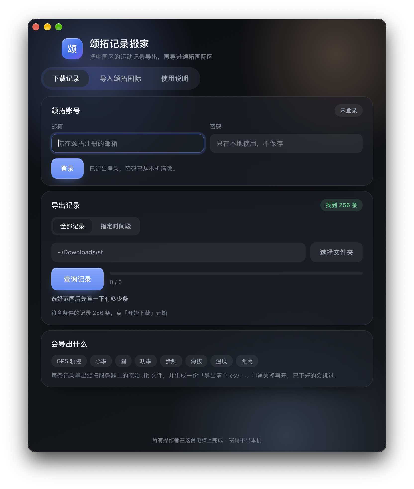
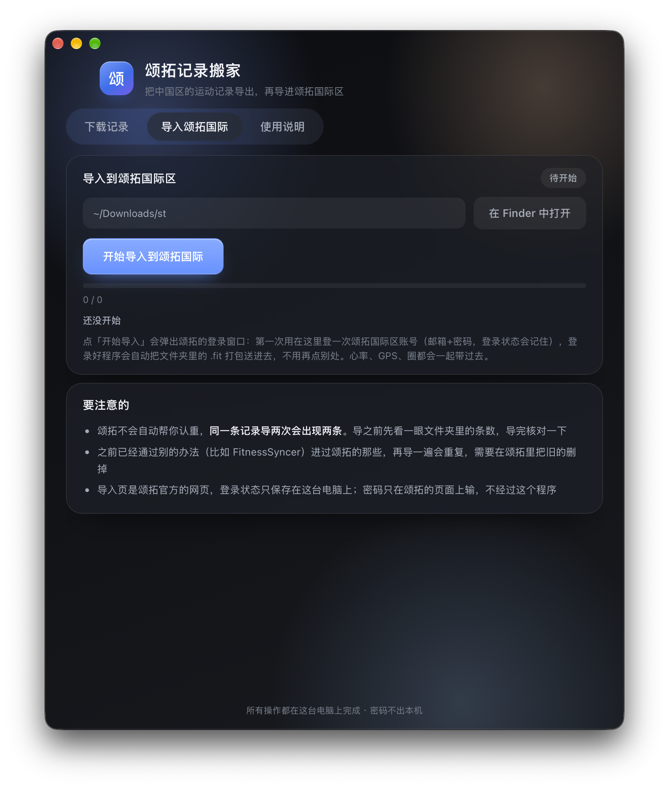
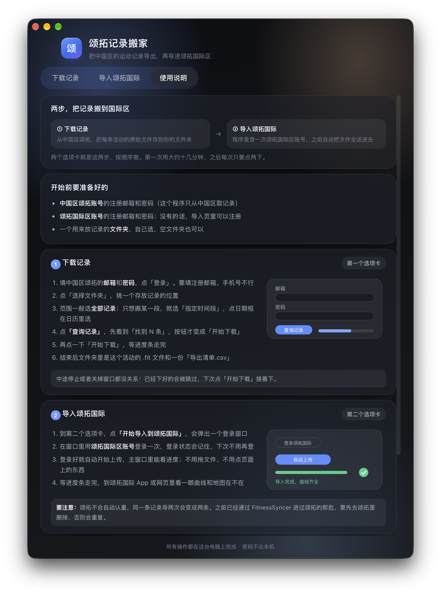

# 颂拓记录搬家 · Suunto Bridge

把 **颂拓中国区账号** 里的运动记录，搬到你的 **颂拓国际区账号**。Mac 和 Windows 桌面程序，两步做完：先从中国区把原始 `.fit` 下载下来，再在程序里登一次国际区账号，自动全部送进去。

> Move your Suunto China activities to your Suunto international account. macOS + Windows, local-first.

## 它做什么

颂拓中国区（`api.suunto.cn`）和国际区（`api.sports-tracker.com`）是两套互不相通的账号，官方没有迁移入口，App 里只能一条一条导出。这个程序把这件事做成两个选项卡：

| 选项卡 | 做什么 |
| --- | --- |
| ① 下载记录 | 登录中国区账号，按「全部」或「指定时间段」把每条活动的原始 `.fit` 存到你的文件夹，并生成「导出清单.csv」 |
| ② 导入颂拓国际 | 点「开始导入」，弹出的窗口里登一次国际区账号；登录状态会记住，登录好程序自动把文件夹里的 `.fit` 打包上传，进度和「成功 N 条 / 失败 M 条」都显示在主窗口 |

第三个选项卡是给第一次用的人看的使用说明。

中途停止、关掉程序都没关系：已下好的文件会跳过，下次接着下。

## 为什么是「下载 + 官方导入页」

导出是读接口，登录就能做；写进颂拓要合作方资格，自己拼请求进不去。

颂拓自己有一个导入页 [`fit.suunto.com`](https://fit.suunto.com)，登录后支持**单个 FIT** 和 **ZIP 批量**导入，记录会作为「自己的活动」进到账号里，**GPS 轨迹和逐点心率曲线都在**。本程序把这一步做进去了：登录窗口就是颂拓官方网页，文件由程序自动提交，不用你拖、不用你点。

> 早前的版本中转过一次 FitnessSyncer。它存着逐点心率，但往颂拓只送摘要（平均值），曲线会丢；所以这条路已经废弃。

## 下载安装

到 [Releases](../../releases) 下载最新版：

| 平台 | 文件 | 说明 |
| --- | --- | --- |
| macOS | `颂拓记录搬家-1.3.0.dmg` | 需要 macOS 13+，**Apple 芯片（M1 及以后）** |
| Windows | `SuuntoBridge-win64-v1.3.0.zip` | Windows 10/11 64 位，解压后运行 `SuuntoBridge.exe`（免安装） |

Mac 版没有做 Apple 开发者签名和公证，**第一次打开要右键点图标 →「打开」→ 再点一次「打开」**。直接双击会被系统拦住。

## 界面与操作

### ① 下载记录



1. 填中国区颂拓的**注册邮箱**和密码，点「登录」（手机号登不进去）
2. 点「选择文件夹」，挑一个存放记录的位置
3. 范围一般选「全部记录」；只想搬某一段，就选「指定时间段」，点日期框在日历里选
4. 点「**查询记录**」，先看到「找到 N 条」，按钮变成「**开始下载**」再点一下
5. 结束后文件夹里是这个活动的 `.fit` 文件和一份「导出清单.csv」

### ② 导入颂拓国际



1. 点「**开始导入到颂拓国际**」，弹出一个颂拓官方窗口
2. 在窗口里用**颂拓国际区账号**登录一次（邮箱 + 密码），登录状态会记住，下次不用再登
3. 登录好自动开始：打包 → 上传，主窗口进度条下面会一路显示「正在打包 / 上传中 42% / 成功 256 条 · 失败 0 条」
4. 完成后到颂拓国际 App 或网页里看一眼曲线和地图在不在

### ③ 使用说明



程序里的「使用说明」选项卡，和上面的步骤是同一套内容。

## 用之前准备好

- 中国区颂拓账号的**注册邮箱**和密码（手机号登不进去）
- 颂拓国际区账号；没有的话，导入窗口里可以注册
- 一个用来放记录的**文件夹**，自己选，空文件夹也可以

## 凭据放在哪

程序里不含任何人的私人凭据，也不上传到别处。全部只在这台电脑上：

| 内容 | 位置（macOS） | 位置（Windows） |
| --- | --- | --- |
| 中国区会话 | `~/Library/Application Support/SuuntoBridge/session-cn.json` | `%APPDATA%\SuuntoBridge\` |
| 中国区账号信息 | `~/.config/suuntool/cn.json`（由 suuntool 维护） | `%USERPROFILE%\.config\suuntool\cn.json` |
| 国际区登录状态 | 程序内嵌网页的站点存储（只在导入窗口里） | 同左 |

- 颂拓密码只交给颂拓服务器（中国区由 suuntool 登录，国际区在颂拓官方页面上输入），**程序不留存**。
- 导入走的是颂拓官方网页，用的是你在那个窗口里登录后拿到的会话凭据，只存在本机的程序数据里。

## 已知限制

- **不认重**：颂拓不会自动去重，同一条记录导两次就会出现两条。导入前先看一眼文件夹里的条数，导完核对一下。
- 之前已经通过别的办法（比如 FitnessSyncer）进过颂拓的那批，再导一遍会重复，需要先在颂拓里把旧的删掉。
- 一次批量导入的文件不超过 **200 MB**（颂拓导入页的上限）；只带 GPS/心率/圈/功率/步频/海拔/温度/距离这些记录本身。
- 导入走的是颂拓网页背后的接口，属于非公开契约，**颂拓改版可能会失效**；失效时程序会把颂拓的原话显示出来。

## 从源码构建

### macOS

要求：macOS 13+、Xcode Command Line Tools（`xcode-select --install`）、底层工具 [suuntool](https://github.com/tajchert/suuntool)。

```sh
# 1. 装 suuntool（MIT，作者 Michal Tajchert）
brew install --cask tajchert/tap/suuntool

# 2. 放进资源目录
mkdir -p SuuntoBridge/Resources/bin
cp "$(command -v suuntool)" SuuntoBridge/Resources/bin/suuntool

# 3. 构建
cd SuuntoBridge && ./build.sh
```

产物是 `SuuntoBridge/build/颂拓记录搬家.app`。打包 dmg：

```sh
mkdir -p /tmp/dmg && cp -R build/颂拓记录搬家.app /tmp/dmg/ && ln -s /Applications /tmp/dmg/应用程序
hdiutil create -volname 颂拓记录搬家 -srcfolder /tmp/dmg -fs HFS+ -format UDZO 颂拓记录搬家.dmg
```

### Windows

要求：Node.js 20+，以及 Windows 版的 `suuntool.exe`（取法同上，放到 `SuuntoBridgeWin/bin/`）。

```sh
cd SuuntoBridgeWin
npm install
npx @electron/packager . SuuntoBridge --platform=win32 --arch=x64 --icon=icon.ico --out=dist --asar \
  --ignore="^/(node_modules|bin|extras|dist)"
mkdir -p dist/SuuntoBridge-win32-x64/resources/bin
cp bin/suuntool.exe dist/SuuntoBridge-win32-x64/resources/bin/
cp icon.ico dist/SuuntoBridge-win32-x64/resources/
```

## 常见问题

- **登录说密码不对**：要用注册邮箱，手机号不行；忘了密码去颂拓网站找回。
- **点了「开始导入」没动静**：会弹出一个颂拓窗口，先在里登录；登录成功程序会自己往下走。
- **卡在「等你登录」**：在窗口里登录成功后，回到主窗口再点一次「开始导入」。
- **报「颂拓没认这批文件」**：把日志里那行原话保留下来，多半是颂拓改接口了或文件超了 200 MB。
- **报「登录过期了」**：在导入窗口里重新登录，再点一次。
- **导重复了**：在颂拓 App 或网页里把多余的那条删掉；颂拓没有批量去重。

## 致谢

本项目的底层取数与登录能力来自 **suuntool**：

- [tajchert/suuntool](https://github.com/tajchert/suuntool) © Michal Tajchert，MIT License（全文见 [NOTICE.md](NOTICE.md)）

以及：

- 导入使用颂拓官方导入页 [`fit.suunto.com`](https://fit.suunto.com)，接口行为按其网页实现
- Windows 版基于 [Electron](https://www.electronjs.org/)（MIT）
- 界面、图标与说明页为本项目自制，界面字体使用系统自带的中文字体渲染

本项目与 Suunto 没有任何隶属或背书关系，相关名称和商标归各自所有者。

## 许可证

[MIT](LICENSE)

## 免责声明

这是第三方工具，按现状提供，不对数据迁移的完整性和结果负责。使用前请确认自己有权导出和搬移这些记录。